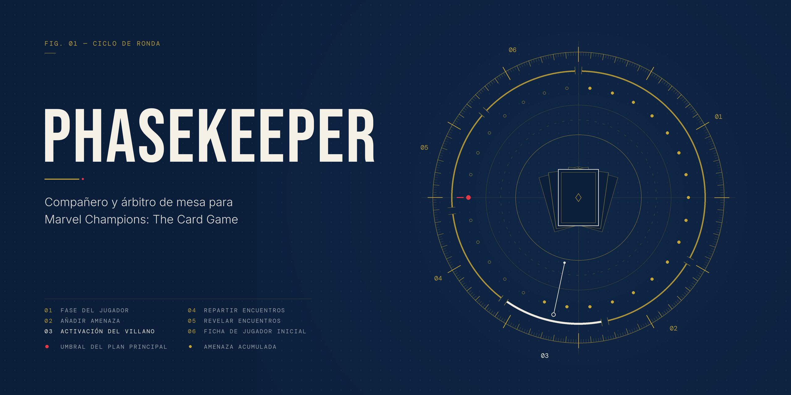

# Phasekeeper

> Compañero de aprendizaje y árbitro para _Marvel Champions: The Card Game_.

Phasekeeper es una app móvil para acompañar una partida **física** de _Marvel Champions_. No es un simulador ni sustituye a las cartas: tú juegas con tu mazo real y la app se encarga de la parte más propensa a errores. Controla al villano, resuelve el mazo de encuentros, lleva la cuenta de la amenaza y te explica cada regla en el momento en que hace falta.

## Qué se puede jugar hoy

**6 escenarios** de 3 cajas, para **1 a 4 jugadores**, en dificultad **Estándar** o **Experto**:

| Caja                 | Escenario                                   | Lo que lo hace especial                                                                                                                               |
| -------------------- | ------------------------------------------- | ----------------------------------------------------------------------------------------------------------------------------------------------------- |
| Core Set             | **Rino**                                    | El escenario de aprendizaje: accesorios (Piel blindada, Embestida), Dureza en el estadio III                                                          |
| Core Set             | **Klaw**                                    | Plan principal de varias etapas; el villano roba 2 cartas de aumento                                                                                  |
| Core Set             | **Ultron**                                  | Drones (cartas boca abajo de tu biblioteca) e inmunidad mientras haya alguno en juego                                                                 |
| The Green Goblin     | **Negocios arriesgados** (Norman Osborn)    | Villano de dos caras y un Entorno con contadores (Infamia / Locura) que le da la vuelta automáticamente                                               |
| The Green Goblin     | **La fórmula mutagénica** (Duende Verde)    | Esbirros de preparación y una aceleración que crece con cada enemigo Duende                                                                           |
| The Wrecking Crew    | **Fuga de prisión** (Destructor, Bola de Trueno, Martinete y Bulldozer) | **Cuatro villanos a la vez** con contador activo, un mazo de encuentros por villano y un plan secundario propio de cada uno que se dispara al llegar a 10 |

**Héroes:** están todos los publicados. La app descarga el catálogo completo de [marvelcdb](https://es.marvelcdb.com) (en español y con caché de 30 días), así que cualquier héroe se puede elegir sin trabajo extra en el código.

**Mazo del pack:** si eliges un héroe y no tienes un mazo guardado para él, la app le monta uno automáticamente con datos de marvelcdb. Lleva sus cartas propias exactas más las cartas de un aspecto y las básicas que trae su pack; el aspecto lo puedes cambiar. No es el mazo preconstruido impreso: marvelcdb no publica esas listas y algunas usan cartas del Core Set. En el Core Set y en las cajas con dos héroes puede quedar fuera del rango de 40 a 50 cartas.

## Cómo funciona: el modelo "compañero"

Esta decisión de diseño condiciona todo lo demás: **la app arbitra el lado del villano, no el tuyo**.

- **Lo que modela el motor:** el villano (estadios, caras, accesorios), los esbirros, los planes principal y secundarios, el mazo de encuentros con su descarte y el Entorno.
- **Lo que haces tú en la mesa:** juegas tus cartas de verdad y le dices a la app lo que has hecho, como atacar, frustrar, cambiar de forma o poner un esbirro en juego.
- **Lo que el motor no puede resolver solo** (aliados, mejoras, la mano del jugador) se queda **guiado**: la app muestra el texto de la carta y te deja aplicarlo con acciones manuales, como "+1 amenaza" o "hacer activo".

## La app

| Pestaña       | Qué hace                                                                                                                                                                                                 |
| ------------- | -------------------------------------------------------------------------------------------------------------------------------------------------------------------------------------------------------- |
| **Inicio**    | Eliges escenario, dificultad, número de jugadores, héroe de cada uno (con buscador) y su mazo: el del pack (con el aspecto que prefieras) o uno guardado                                                |
| **Partida**   | El asistente de la ronda paso a paso: amenaza, activación del villano, reparto y revelado de encuentros, ataques, frustrar, Entorno, varios villanos, biblioteca simulada (robar, jugar, descartar), explicación de cada evento |
| **Cartas**    | Catálogo de las cartas de encuentro con su imagen                                                                                                                                                         |
| **Reglas**    | Glosario de palabras clave (español / inglés) con buscador                                                                                                                                                |
| **Colección** | Tus mazos guardados (incluidos los del pack) con la validación de las reglas de mazo (aspecto, tamaño, copias) y un visor de cartas. El editor de mazos aún no está hecho                              |
| **Más**       | Reiniciar la partida y enlace al reglamento                                                                                                                                                              |

La partida se guarda sola en SQLite y se recupera al volver a abrir la app.

## Stack tecnológico

| Capa               | Tecnología                                                       |
| ------------------ | ---------------------------------------------------------------- |
| App móvil          | React Native 0.88 + Expo 58 + Expo Router + TypeScript           |
| Estilos            | NativeWind (Tailwind) · tipografías Bebas Neue e Inter           |
| Motor de juego     | TypeScript puro y estricto, sin dependencias de React Native     |
| Tests              | Vitest                                                           |
| Persistencia local | SQLite (`expo-sqlite`)                                           |
| Datos de cartas    | API pública de marvelcdb                                         |
| Gestor de paquetes | pnpm (workspaces / monorepo)                                     |

## Estructura del repositorio

```
MarvelChampionsCompanion/
├── docs/
│   ├── Content roadmap.md          # Plan para cubrir todo el contenido del juego
│   ├── Claude code brief.md        # Reglas de trabajo para añadir villanos
│   ├── rules-specs.md              # Secuencia de ronda verificada + glosario
│   ├── marvel-champions-rules-reference.md
│   ├── Scenario-Rhino.md           # Cartas del escenario de Rino (EN/ES)
│   ├── test cases.md               # Casos de prueba en dado / cuando / entonces
│   └── assets/portada.png
│
├── engine/                          # Motor de juego (TypeScript puro)
│   ├── src/
│   │   ├── domain/                   # GameState y tipos del estado
│   │   ├── data/cards.ts             # Catálogo de 147 cartas de encuentro verificadas
│   │   ├── scenarios/                # Un archivo por escenario (datos, no código)
│   │   ├── game/                     # Fases, activación, encuentros, estadios, varios villanos…
│   │   ├── effects/                  # Sistema genérico de Effects
│   │   ├── events/                   # GameEvent y log de eventos
│   │   ├── explanations/             # Explicaciones en español + asistente paso a paso
│   │   ├── deck/                     # Reglas de mazos y "mazo del pack" de cada héroe
│   │   └── persistence/              # Serialización y migración de partidas guardadas
│   └── tests/                        # 307 tests de Vitest
│
├── mobile/                          # App Expo
│   ├── app/                          # Pantallas (Expo Router): Inicio, pestañas, editor de mazo
│   ├── services/                     # Catálogo de marvelcdb, héroes, índice de cartas
│   └── storage/                      # SQLite: partida, mazos y caché del catálogo
│
├── pnpm-workspace.yaml
└── package.json
```

## Arquitectura del motor

```
GameState
   ├── scenarioId          (clave del escenario; el nombre del villano puede cambiar)
   ├── players[]           (vida, forma, cartas de encuentro boca abajo, biblioteca simulada)
   ├── villain             (estadio, cara, PG, ATQ/PLA, accesorios)
   ├── reserveVillains[]   (solo con varios villanos: los que no tienen el contador activo)
   ├── environment         (Entorno con contadores, si el escenario lo usa)
   ├── schemes[]           (plan principal por etapas + secundarios, incluidos los propios de un villano)
   ├── minions[]
   ├── encounterDeck / encounterDiscard / encounterShuffleSeed
   └── eventLog[]

Cada resolución es una función pura:
  (state, ...) => { state: nuevo GameState, events: GameEvent[] }

Los efectos son datos:
  { type: 'DEAL_DAMAGE', target: {...}, amount: 2, source: '...' }

Y cada evento se traduce a una explicación en español:
  explainEvent(evento) → { title, description, reason, nextStep }
```

**Escenarios como datos.** Un escenario es una `ScenarioDefinition`: estadios con PG por jugador, plan principal con sus etapas, mazo de encuentros, progresión Estándar/Experto y habilidades declaradas (por ejemplo "+2 ATQ si no es defendido" o "coloca la amenaza en su plan propio"). Para añadir un villano basta con sus datos y, si trae una mecánica nueva, el sistema que la resuelve.

**Sistemas que ya existen en el motor:**
- **Planes:** plan principal de varias etapas; amenaza inicial y umbrales por jugador; aceleración fija, variable o por tokens; iconos de Aceleración, Crisis y Peligro; efectos "cuando se complete".
- **Keywords:** Oleada, Guardia, Dureza y Represalia.
- **Ultron:** Drones e inmunidad mientras haya alguno en juego.
- **Norman Osborn:** villano de dos caras y Entorno con contadores que lo voltea automáticamente.
- **The Wrecking Crew:**
  - varios villanos a la vez con contador activo;
  - un mazo de encuentros por villano;
  - planes secundarios propios;
  - ataque a cualquier villano y victoria al derrotar al último.
- **Común a todos los villanos:** un núcleo "el villano X ataca / maquina" con todas sus habilidades; los accesorios suman ATQ en cualquier ataque.

**Determinista y reproducible.** El motor nunca usa `Math.random`. El mazo se baraja con una semilla guardada en el estado, que la app elige al crear la partida, y la biblioteca del jugador se baraja con un barajador que inyecta la app. La misma semilla da la misma partida, y los tests no dependen del azar.

## Principios de diseño

1. **El motor no depende de React Native.** Todo `engine/` es TypeScript puro y podría ejecutarse en cualquier entorno Node.
2. **Nada de reglas inventadas.** Cada carta y cada cifra se verifican contra marvelcdb, y las reglas contra el Rules Reference o el inserto oficial del escenario. Lo que no está claro se documenta como asunción en un único punto del código.
3. **TypeScript estricto, sin atajos:** `strict`, `noUncheckedIndexedAccess`, `exactOptionalPropertyTypes`. Nada de `any` ni `@ts-ignore`.
4. **Modo árbitro.** Se modela lo que el motor puede resolver con fidelidad. Lo demás se guía con el texto de la carta y se documenta en el archivo del escenario.
5. **Estado inmutable + eventos.** Ninguna función muta el estado, y los eventos alimentan el log y las explicaciones.
6. **Offline-first.** El motor no necesita internet. La app solo descarga el catálogo de héroes y las imágenes de las cartas, y los guarda en caché.

## Puesta en marcha

Necesitas Node.js 20 o superior, pnpm y la app Expo Go en un móvil Android (o un emulador).

```bash
git clone https://github.com/ernestogba3/MarvelChampionsCompanion.git
cd MarvelChampionsCompanion
pnpm install

# Motor: tests y comprobación de tipos
cd engine
pnpm test
pnpm typecheck

# App: comprobación de tipos y arranque
cd ../mobile
npx tsc --noEmit
npx expo start
```

Después, escanea el código QR con Expo Go.

## Limitaciones conocidas

Todas están anotadas en [`docs/Content roadmap.md`](docs/Content%20roadmap.md):

- **No modelado (se resuelve a mano en la mesa):**
  - aliados, defensa, recursos y la mano del jugador;
  - la Brutalidad de Embestida;
  - las cartas que dependen de esos elementos.
- **Encuentros en alter ego:** un jugador en alter ego todavía no recibe su carta de encuentro base en el paso 3.
- **Tratados sin carta de aumento:** Agresión y Todos a una no le dan carta de aumento al villano.
- **Mazos de jugador:**
  - aún no hay editor de mazos ("Nuevo mazo" en Colección no lleva a ningún editor);
  - Masacre solo recibe sus cartas propias, porque el aspecto "Pool" no está contemplado.
- **Sets de némesis y obligaciones:** aún no existen. El hueco está preparado (`reservedNemesis`).
- **The Wrecking Crew:** sin el modo "desafío extremo" (versión A y luego B) ni mezclas de versiones A/B.
- **TC-014:** falta confirmar contra el reglamento físico en qué momento exacto se comprueba la derrota por amenaza.

## Próximos pasos

Según [`docs/Content roadmap.md`](docs/Content%20roadmap.md):

- **Fase A: el resto de packs de escenario.** Ronan y The Hood (posiblemente sets modulares, pendiente de confirmar), MojoMania, Trickster Takeover y Synthezoid Smackdown.
- **Fase B: las cajas de campaña, por orden de salida.** De _The Rise of Red Skull_ a _Fear No Evil_.
- **Sistemas pendientes:**
  - sets modulares;
  - némesis y obligaciones;
  - carta de encuentro base para los jugadores en alter ego;
  - recursos e interacción.

## Aviso

Proyecto personal y no oficial, sin relación con Fantasy Flight Games ni Marvel. _Marvel Champions: The Card Game_ y todos sus personajes son marcas de sus respectivos propietarios. Los datos y las imágenes de las cartas proceden de [marvelcdb](https://marvelcdb.com).
